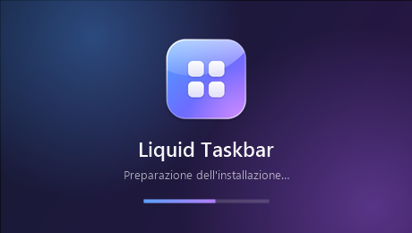

<p align="center">
  
</p>

<h1 align="center">Liquid Taskbar</h1>

<p align="center">
  La taskbar di Windows 11 ridisegnata in stile <b>Liquid Glass</b>.<br>
  Creata da <a href="https://github.com/OnlyG4BB0"><b>OnlyG4BB0</b></a>
</p>

---

## Scarica

👉 **[Scarica l'ultima versione](https://github.com/OnlyG4BB0/liquid-taskbar/releases/latest)**: `LiquidTaskbar-Setup-1.0.2.exe`

Apri il file e segui il wizard. Non servono permessi di amministratore.
Al termine la barra è subito attiva e parte da sola a ogni avvio di Windows.

> Windows SmartScreen potrebbe avvisare che l'app non è riconosciuta, perché non è firmata digitalmente:
> clicca **Ulteriori informazioni → Esegui comunque**.

## Cosa fa

- **Vetro liquido vero**: rifrazione, riflessi e una "bolla" che segue il mouse, con lo sfondo che cambia dal vivo
- **Start in vetro** con app aggiunte, consigliati, tutte le app e ricerca
- **Impostazioni rapide**: rete, volume, luminosità, tema scuro, intensità del vetro e del testo
- **Centro notifiche e calendario**, con le notifiche vere di Windows
- **Area di notifica** con le icone delle app in background e il pannello **^**
- Le **app fissate** restano sincronizzate con quelle di Windows; si riordinano trascinando
- **Barra a scomparsa**: compare portando il mouse sul bordo inferiore
- Tasti: **Win** Start · **Win+A** impostazioni rapide · **Win+N** notifiche · **Win+S** ricerca
- **Vetro anche sulle finestre** di Windows (barre del titolo acriliche), disattivabile
- **Sempre attiva**: parte con Windows e, se si chiude per un errore, si riavvia da sola

## Requisiti

Windows 10 o 11 a 64 bit.

## Disinstallare

*Impostazioni → App → App installate → Liquid Taskbar → Disinstalla*.
La taskbar di Windows torna esattamente com'era.

Per tornare alla taskbar di Windows senza disinstallare: tasto destro sulla barra → **Esci da Liquid Taskbar**.

## Installazione senza finestra

```
LiquidTaskbar-Setup-1.0.2.exe --silent
```

Installa o aggiorna mantenendo le impostazioni già scelte.

---

<p align="center">© 2026 <a href="https://github.com/OnlyG4BB0">OnlyG4BB0</a>. Tutti i diritti riservati.</p>
